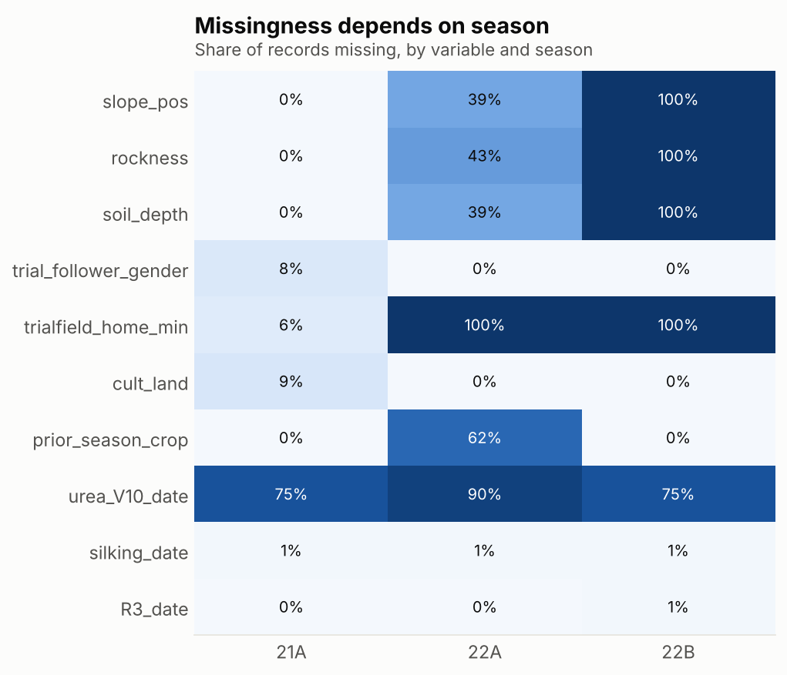
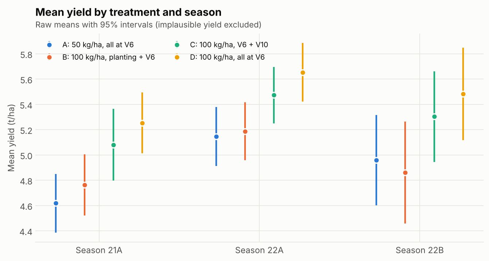
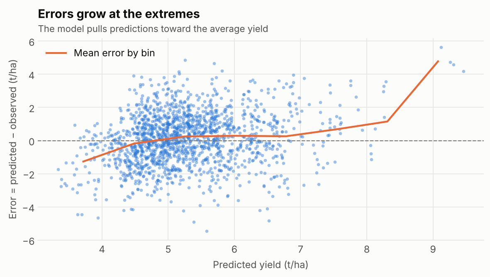
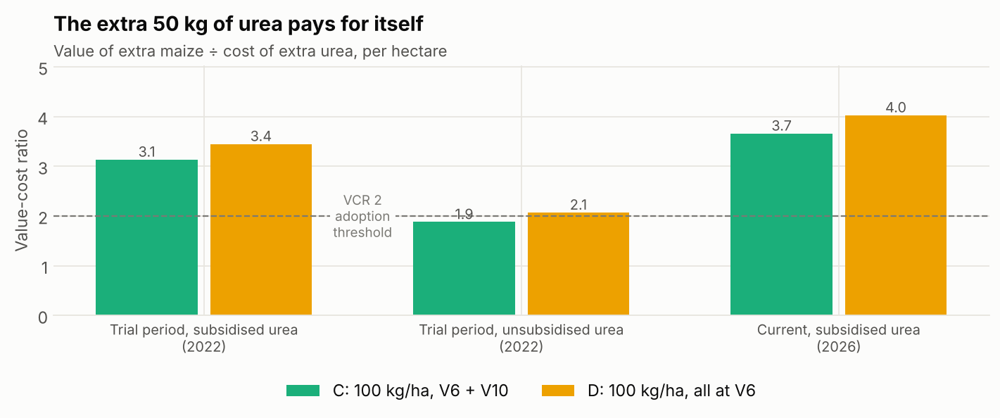
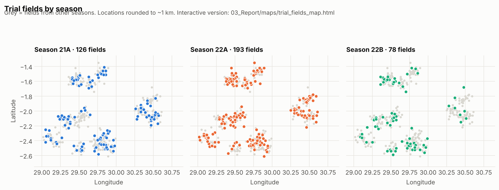

# Urea rate and timing for maize in Rwanda

**Analysis report for Evergreen Global R&D**  
Vincent Okumu · November 2026 · [Project charter](../00_Project_Management/project_charter.md) · [Data audit log](../01_Data/audit/data_audit_log.md)

> **Data note.** The original trial data is confidential, so this report is based on a **synthetic dataset** (`01_Data/sample/`) with the same structure, variables and data-quality problems. Every number, table and chart below comes from that synthetic data. The results demonstrate the method and deliverables; they are not Evergreen's actual findings.

---

## Summary

**Recommendation: apply 100 kg/ha of Urea, all at V6, in every mega-environment.**

* **It gives the most maize.** Compared with the current 50 kg/ha at V6, it adds **0.55 t/ha** (95% CI 0.34–0.75), about **11%**, after adjusting for season, environment and field. It ranked first in all four mega-environments.
* **It pays.** At trial-period prices, every franc spent on the extra 50 kg of Urea returned **3.4 francs** of maize (value-cost ratio, VCR). At 2026 prices it returns **4.0**. With unsubsidised Urea the VCR is 2.1, just above the usual adoption threshold of 2.
* **Splitting 100 kg/ha between V6 and V10 is a statistically equivalent alternative overall** (+0.50 t/ha; difference from all-at-V6 p = 1.00). It needs a second field visit, its estimate depends on one suspect record, and it fell behind all-at-V6 in two environments, so it is the second choice.
* **Don't split between planting and V6.** It adds only 0.05 t/ha (not significant) and returns a third of the cost of the extra Urea (VCR 0.3).
* **One rule is enough.** Treatment effects did not differ significantly between mega-environments (p = 0.08) or seasons (p = 0.10).
* **Where the field is matters more than which treatment it gets.** Mega-environment is by far the strongest predictor of yield; Low-Mid-Dry fields yield about 1.2–1.4 t/ha more than the others.

---

## 1. Objectives

| # | Question | Where answered |
|---|---|---|
| 1 | Which Urea rate–timing combination gives the highest yield in each mega-environment, and are the differences significant? | §4.1–4.3 |
| 2a | What are the most important drivers of yield? | §4.5 |
| 2b | Where should each combination be recommended? Decision-support tool | §4.7–4.8 |
| 3 | A yield-prediction model and its quality | §4.6 |
| 4 | Map of trial fields by season | §4.9 |

## 2. Data

Three tables covering three seasons (21A, 22A, 22B): 397 field records, 1,590 plots and 685 soil records. Each field was split into four plots, one per treatment:

| Code | Treatment | Rate | Timing |
|---|---|---:|---|
| A | Current practice (baseline) | 50 kg/ha | All at V6 |
| B | Planting + V6 | 100 kg/ha | Half at planting, half at V6 |
| C | V6 + V10 | 100 kg/ha | Half at V6, half at V10 |
| D | All at V6 | 100 kg/ha | All at V6 |

### Data quality

The [data audit log](../01_Data/audit/data_audit_log.md) records 22 checks. The pipeline rebuilds it from the data on every run, so its counts always match the data. The issues that affect the analysis:

| Issue | Scale | How it was handled |
|---|---|---|
| Plots with no field record | 8 plots (2 units) | Kept and flagged; excluded only from models that need mega-environment |
| Incomplete field units | 5 units, 14 plots | Kept; mixed model handles unbalanced units |
| Implausible yield | 1 plot at 55 t/ha (next highest 11.4) | Kept; every key result also reported without it |
| V10 date missing, quantity recorded | 115 plots, all in 22A | Assumed applied; dates not imputed |
| Soil measured on only some plots | 685 of 1,590 plots (43%), 25–75% by season | pH used only for soil-specific checks; SoilGrids planned for full coverage |
| Empty soil variables | N, organic C, sand 100% empty | To be filled from SoilGrids (`scripts/fetch_soilgrids.py`) with the real coordinates |
| Implausible altitudes | 3 fields at 0–0.26 m | Set to missing in `alt_clean`; original kept |
| Growth-stage order | 3 plots with R3 before silking | Flagged; excluded from date-based variables only |

Nothing was deleted or overwritten. Every correction is a new column or a flag, so the original values can always be traced. The result is one combined dataset with one row per plot (1,590 rows).

Missingness follows the season, not the field. Several field variables were not collected in later seasons, so they are not imputed in the treatment models.

## 3. Methods

**Treatment effects.** Plots in the same field share soil, weather and management. A linear mixed-effects model with a random intercept for each field-season unit uses that structure:

`yield ~ treatment + season + mega-environment + (1 | field-season)`

Adjusted means average the model's predictions over the observed mix of seasons and environments. All six pairwise treatment comparisons use Holm-corrected p-values. Likelihood-ratio tests check whether treatment effects differ by mega-environment or season. Separate models fitted within each mega-environment give local estimates.

**Drivers and prediction.** A random forest was compared with ridge regression and a mean-only baseline using **grouped 5-fold cross-validation**: every plot from a field is in the same fold, so performance is measured on fields the model has never seen. The prediction model uses only information available before planting. Driver importance uses a wider set (including in-season variables such as germination) and is measured by **permutation importance on held-out fields**: how much prediction error grows when a variable is shuffled.

**Economics.** The value-cost ratio is the value of extra maize divided by the cost of the extra Urea, against the 50 kg/ha baseline. A VCR of 2 or more is a common threshold for smallholder adoption. Three price scenarios come from published sources (see [Sources](#sources)).

**Reproducibility.** `python run_pipeline.py` regenerates every table, figure, map and the decision tool from the source files. The [notebooks](../02_Notebooks) walk through the same steps with commentary.

## 4. Results

### 4.1 Overall treatment effects

| Treatment | Adjusted mean (t/ha) | Gain vs A (t/ha) | 95% CI | Holm p |
|---|---:|---:|---|---:|
| A: 50 kg/ha, all at V6 | 4.94 | – | – | – |
| B: 100 kg/ha, planting + V6 | 4.99 | +0.05 | −0.15 to 0.26 | 1.00 |
| C: 100 kg/ha, V6 + V10 | 5.44 | +0.50 | 0.29 to 0.70 | < 0.001 |
| **D: 100 kg/ha, all at V6** | **5.49** | **+0.55** | **0.34 to 0.75** | **< 0.001** |

*Model: 1,582 plots in 397 field-season units.*

The other pairwise comparisons:

| Comparison | Difference (t/ha) | Holm p |
|---|---:|---:|
| D vs C | +0.05 | 1.00 |
| D vs B | +0.50 | < 0.001 |
| C vs B | +0.45 | < 0.001 |

The extra Urea pays off **when it is applied at V6 or later**. Putting half of it at planting gives almost all of the benefit away, consistent with nitrogen applied before the crop can use it being lost to leaching or runoff.

### 4.2 Best treatment in each mega-environment (Objective 1)

| Mega-environment | Fields | Best treatment | Gain vs A (95% CI) | Runner-up | Best vs runner-up, Holm p |
|---|---:|---|---|---|---:|
| Highlands | 142 | D: all at V6 | +0.50 (0.32 to 0.69) | C | **0.046** |
| Low-Mid-Dry | 114 | D: all at V6 | +0.59 (0.39 to 0.80) | C | **0.045** |
| Low-Mid-Wet | 77 | D: all at V6 | +0.62 (0.35 to 0.90) | C | 0.71 |
| Transitional | 64 | D: all at V6 | +0.48 (0.23 to 0.74) | C | 0.97 |

*Separate model per environment; the 55 t/ha record (a Transitional plot) is excluded so it does not distort that environment's estimate.*

**D ranks first everywhere, and its gain over the baseline is significant in every environment.** In the Highlands and Low-Mid-Dry, D also beats C, by about 0.2 t/ha. In Low-Mid-Wet and Transitional, D and C are statistically tied. B gives no significant gain in any environment.

### 4.3 Does the answer change by environment or season?

| Test | LR statistic | df | p |
|---|---:|---:|---:|
| Treatment × mega-environment | 15.36 | 9 | 0.08 |
| Treatment × season | 10.66 | 6 | 0.10 |

Neither interaction is significant at 5%, so the **pooled estimate is the best basis for advice** in every environment. It is also more precise than any single environment's estimate. The environment test (p = 0.08) is close enough to the threshold that the per-environment results in §4.2 are worth reading alongside the pooled one: they agree on the winner and differ only in how far C trails D.

### 4.4 Sensitivity to the implausible yield

| Treatment | Gain, all plots | Gain without 55 t/ha | Holm p without |
|---|---:|---:|---:|
| B | +0.05 | +0.05 | 0.36 |
| C | +0.50 | **+0.38** | < 0.001 |
| D | +0.55 | +0.55 | < 0.001 |

D's estimate does not move. C's falls by 0.12 t/ha, because the suspect record is a C plot; this is one reason C is the second choice. B stays small and non-significant either way. Residual diagnostics are otherwise acceptable:

About 42% of the yield variance lies between fields, which confirms that the random field effect is needed.

### 4.5 What drives yield (Objective 2a)

* **Mega-environment dominates.** Shuffling it raises prediction error by 0.16 t/ha, more than ten times any other variable. Low-Mid-Dry fields yield about 1.2–1.4 t/ha more than fields elsewhere.
* **Everything else matters little.** Seed rate, soil colour, slope, season and land cultivated each add less than 0.015 t/ha, and their fold-to-fold variation is as large as their importance. Slope shows no effect: flat and steep fields average the same yield (5.1–5.25 t/ha).
* **Urea treatment ranks 7th of 18 for *predicting* yield**, even though its effect is real and consistent (§4.1). A 0.5 t/ha treatment gain is small next to the differences between environments.
* **No management variable has a significant within-field effect.** In the mixed model, compost, seed rate and germination rate all have p > 0.4. DAP could not be tested because every plot received the same rate.
* **Why the ranking looks like this:** the synthetic yields were simulated from mega-environment, season, treatment and field effects only, so the ranking mostly reflects how the data was built. With the real trial data, this analysis is what reveals which site and management factors matter, and the CHIRPS rainfall and SoilGrids soil variables enter it automatically once the enrichment has been run.

Permutation importance measures predictive association, not cause. Correlated variables share their importance.

### 4.6 Yield prediction (Objective 3)

| Model | MAE (t/ha) | RMSE (t/ha) | R² |
|---|---:|---:|---:|
| **Ridge regression** | **1.25** | **1.99** | **0.03** |
| Random forest | 1.27 | 2.02 | 0.01 |
| Mean-only baseline | 1.29 | 2.03 | −0.01 |
| *Random forest, without the 55 t/ha record* | *1.20* | *1.52* | *0.09* |

*Grouped 5-fold CV: each field's plots are predicted by a model that never saw that field. Pre-planting information only.*

Both models barely beat guessing the average: ridge regression cuts error by about 3%. Accuracy is similar across mega-environments (MAE 1.2–1.4 t/ha, highest in Transitional). The synthetic fields carry little information beyond environment, season and treatment, so **the model is not useful for forecasting individual farms**. With real data, rainfall and soil variables are the most likely route to a better model.

### 4.7 Is the extra Urea worth it?

| Price scenario | Urea (RWF/kg) | Maize (RWF/kg) | VCR, D | Net gain, D (RWF/ha) | VCR, C | VCR, B |
|---|---:|---:|---:|---:|---:|---:|
| Trial period, subsidised (2022) | 754 | 237 | **3.4** | +92,300 | 3.1 | 0.3 |
| Trial period, unsubsidised (2022) | 1,257 | 237 | **2.1** | +67,100 | 1.9 | 0.2 |
| Current, subsidised (2026) | 1,090 | 400 | **4.0** | +164,900 | 3.7 | 0.4 |

At trial-period prices, D needs only **0.16 t/ha** of extra maize to break even, well below the lower end of its confidence interval (0.34 t/ha). Even at that lower bound, the VCR is 2.2 at subsidised prices. Two caveats. If the Urea subsidy were removed, D would only just clear the threshold and C would fall below it. And labour for C's second application is not costed, which favours D further.

### 4.8 Where to recommend each combination (Objective 2b)

| Combination | Recommend? | Where | Why |
|---|---|---|---|
| **D: 100 kg/ha, all at V6** | **Yes, default** | All four mega-environments | Highest yield everywhere; significant gain in each environment; VCR 3.4–4.0 |
| C: 100 kg/ha, V6 + V10 | Alternative | Where farmers prefer to split the cost or labour; best suited to Low-Mid-Wet and Transitional, where it ties with D | Equivalent overall (p = 1.00 vs D), but lower than D in the Highlands and Low-Mid-Dry (p ≈ 0.05), sensitive to one record, and needs an extra visit |
| B: 100 kg/ha, planting + V6 | No | – | Negligible gain (+0.05 t/ha) that does not pay for the extra Urea (VCR 0.3) |
| A: 50 kg/ha, all at V6 | Fallback | If Urea becomes unsubsidised **and** maize prices fall | Becomes the better choice once D's VCR drops below 2 (urea/maize price ratio above ~5.5) |

**Decision rule (implemented in the tool):** recommend the highest-yielding treatment that is (1) significantly better than 50 kg/ha and (2) has a VCR ≥ 2 at current local prices. Otherwise keep 50 kg/ha.

**The [decision-support tool](decision_tool/index.html)** is a single offline HTML page. A user picks a mega-environment and enters local Urea and maize prices. The tool returns the recommended treatment, the expected gain with its confidence interval, the VCR and net benefit, and a comparison of pooled and local estimates. Open the file in any browser.

### 4.9 Trial fields (Objective 4)

397 field-seasons across 14 districts: 126 in 21A, 193 in 22A and 78 in 22B. Every season covers all 14 districts, but 22B has far fewer fields, so its season estimates are less precise. An [interactive map](maps/trial_fields_map.html) lets you toggle seasons and hover for district, environment and median yield. Locations in the synthetic data are made up; for real data, published locations are rounded to about 1 km and the exact map stays local.

## 5. Limitations

* **Synthetic data.** All results come from a simulated dataset. They show what the analysis produces, not what Evergreen's trial found.
* **Rainfall and soil enrichment is not included.** The CHIRPS and SoilGrids scripts need real field coordinates; for the synthetic sample they are switched off. With real data, they are cached, rate-limited and resumable, and the pipeline picks up their output automatically.
* **Three seasons, one trial design.** The interaction tests have limited power. A real but small environment-specific difference could go undetected, and the environment test here is borderline (p = 0.08).
* **The economics is a partial budget.** It excludes labour, transport, credit and risk, and uses national reference prices, not local ones.
* **Data recording gaps.** These include missing V10 dates in 22A, 8 plots with no field record, one implausible yield and uneven soil sampling. Each is documented and handled transparently.

## 6. Recommendations and next steps

1. **Adopt 100 kg/ha of Urea, all at V6, as the default recommendation** across all four mega-environments, with V6 + V10 as an accepted alternative where it ties (Low-Mid-Wet and Transitional).
2. **Tailor expectations by environment.** Mega-environment moves yield far more than fertiliser choice does, so expected yields and returns should be set per zone.
3. **Check profitability each season** with the decision tool as Urea subsidies and maize prices change. Revert to 50 kg/ha if the VCR falls below 2.
4. **Run the CHIRPS and SoilGrids enrichment on the real data** and re-run the pipeline. This tests whether rainfall or soil fertility changes where extra Urea pays.
5. **Resolve open data queries with the field team** (audit items AUD-03, AUD-08, AUD-11 and AUD-13), and record application dates for every split dose in future trials.
6. **Validate in new sites and seasons**, especially more 22B-type (short-rain) seasons, which have the fewest fields.

---

## Sources

* Urea and DAP prices, 2022: [AGRA Price & Policy Monitor, August 2022](https://agra.org/archive/wp-content/uploads/2022/09/Price-and-Policy-Monitor-August-edition-5.pdf) (urea RWF 1,257/kg market price, RWF 754/kg to farmers after subsidy)
* Maize farm-gate price, 2022: [MINICOM via Tridge, February 2022](https://www.tridge.com/news/rwanda-govt-raises-maize-prices-to-offset-farmers-) (RWF 237/kg)
* Urea price, 2026: [The New Times, July 2026](https://www.newtimes.co.rw/article/37366/news/agriculture/how-rwandas-fertiliser-subsidy-scheme-works/amp) (RWF 1,980/kg retail; farmers pay RWF 1,090/kg after 45% subsidy)
* Maize farm-gate minimum: [MINICOM via Milling MEA, 2024](https://millingmea.com/?p=2019330) (RWF 400/kg threshed grain)
* CHIRPS: Funk, C. et al. (2015). *The climate hazards infrared precipitation with stations.* Scientific Data 2, 150066.
* SoilGrids 2.0: Poggio, L. et al. (2021). *SoilGrids 2.0: producing soil information for the globe with quantified spatial uncertainty.* SOIL 7, 217–240.

**Use of AI tools.** Claude (Anthropic) was used to review the repository, refactor the analysis into the `src/maize` pipeline, write tests and draft this report. All analytical choices and results were checked by the analyst.
