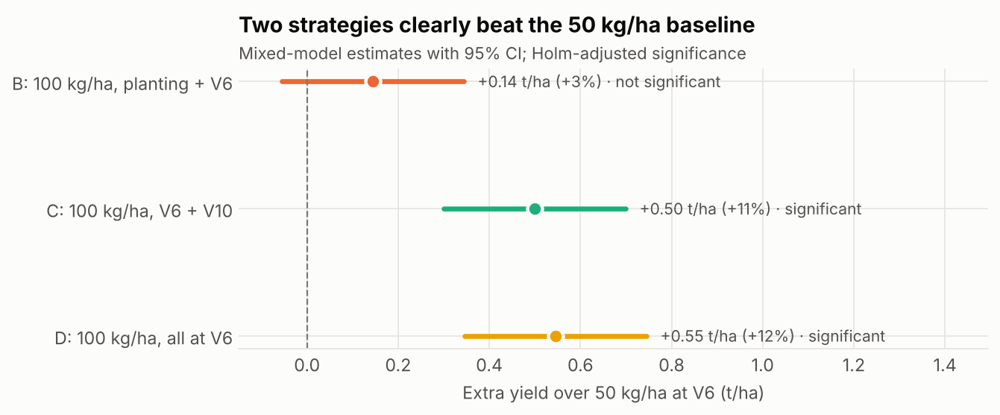
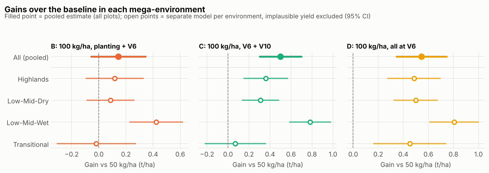
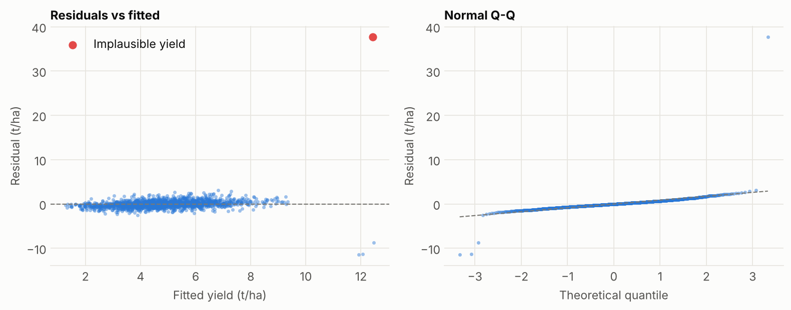
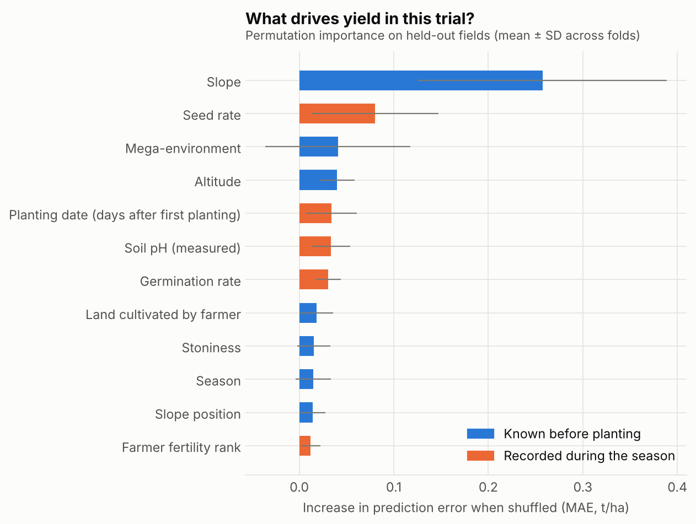
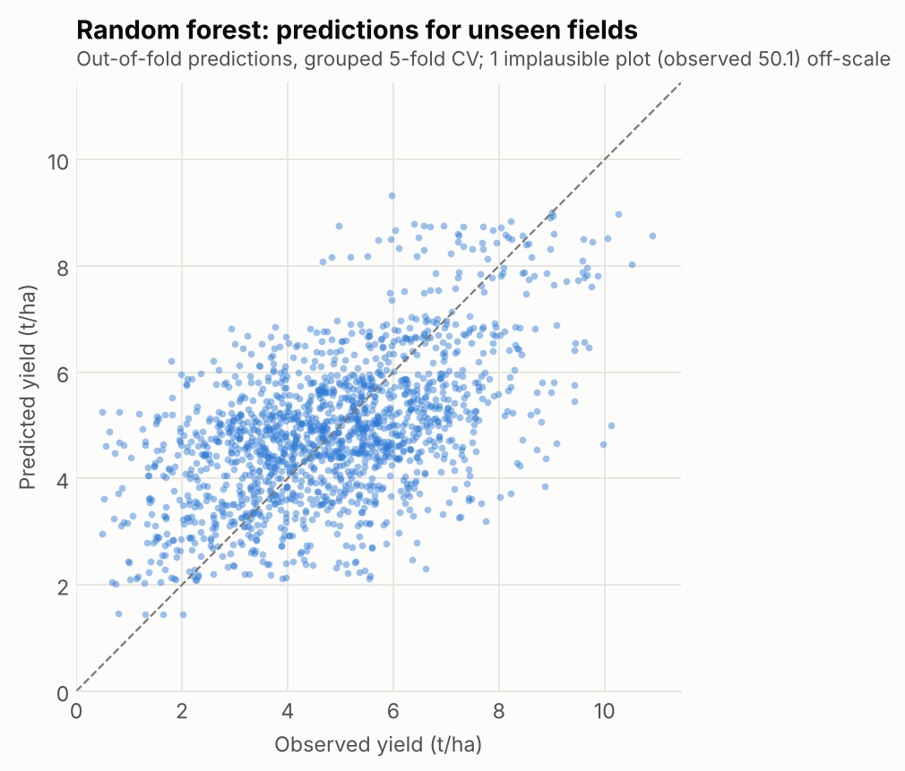

# Urea rate and timing for maize in Rwanda

**Analysis report for Evergreen Global R&D**  
Vincent Okumu · November 2026 · [Project charter](../00_Project_Management/project_charter.md) · [Data audit log](../01_Data/audit/data_audit_log.md)

---

## Summary

**Recommendation: apply 100 kg/ha of Urea, all at V6, in every mega-environment.**

* **It gives the most maize.** Compared with the current 50 kg/ha at V6, it adds **0.55 t/ha** (95% CI 0.35–0.75), about **12%**, after adjusting for season, environment and field. It ranked first in all four mega-environments.
* **It pays.** At trial-period prices, every franc spent on the extra 50 kg of Urea returned **3.4 francs** of maize (value-cost ratio, VCR). At 2026 prices it returns **4.0**. Even unsubsidised Urea stays just above the usual adoption threshold of 2.
* **Splitting 100 kg/ha between V6 and V10 is a statistically equivalent alternative** (+0.50 t/ha; difference from all-at-V6 p = 0.65). It needs a second field visit and its estimate depends on one suspect record, so it is the second choice.
* **Don't split between planting and V6.** It adds only 0.14 t/ha and does not cover the cost of the extra Urea (VCR 0.9).
* **One rule is enough.** Treatment effects did not differ significantly between mega-environments (p = 0.42) or seasons (p = 0.10).
* **Where the field is matters far more than which treatment it gets.** Slope, altitude, planting date and germination explain much more of the yield variation than Urea treatment. Flat fields averaged about 2 t/ha more than steep ones.

---

## 1. Objectives

| # | Question | Where answered |
|---|---|---|
| 1 | Which Urea rate–timing combination gives the highest yield in each mega-environment, and are the differences significant? | §4.1–4.3 |
| 2a | What are the most important drivers of yield? | §4.5 |
| 2b | Where should each combination be recommended? Decision-support tool | §4.7–4.8 |
| 3 | A yield-prediction model and its quality | §4.6 |
| 4 | Map of trial fields by season | §4.9 |

## 2. Data

Three tables from a three-season on-farm trial (21A, 22A, 22B): 399 field records, 1,598 plots and 736 soil records. Each field was split into four plots, one per treatment:

| Code | Treatment | Rate | Timing |
|---|---|---:|---|
| A | Current practice (baseline) | 50 kg/ha | All at V6 |
| B | Planting + V6 | 100 kg/ha | Half at planting, half at V6 |
| C | V6 + V10 | 100 kg/ha | Half at V6, half at V10 |
| D | All at V6 | 100 kg/ha | All at V6 |

### Data quality

The [data audit log](../01_Data/audit/data_audit_log.md) records 22 checks. The pipeline rebuilds it from the data on every run, so its counts always match the data. The issues that affect the analysis:

| Issue | Scale | How it was handled |
|---|---|---|
| Plots with no field record | 5 plots (2 units) | Kept and flagged; excluded only from models that need mega-environment |
| Incomplete field units | 5 units, 14 plots | Kept; mixed model handles unbalanced units |
| Implausible yield | 1 plot at 50.1 t/ha (next highest 10.9) | Kept; every key result also reported without it |
| V10 date missing, quantity recorded | 115 plots, all in 22A | Assumed applied; dates not imputed |
| Soil measured on only some plots | 736 of 1,598 plots (46%), 24–69% by season | pH used only for soil-specific checks; SoilGrids added for full coverage |
| Empty soil variables | N, organic C, sand 100% empty | Filled from SoilGrids (`scripts/fetch_soilgrids.py`) |
| Implausible altitudes | 3 fields at 0–0.26 m | Set to missing in `alt_clean`; original kept |
| Growth-stage order | 3 plots with R3 before silking | Flagged; excluded from date-based variables only |

Nothing was deleted or overwritten. Every correction is a new column or a flag, so the original values can always be traced. The result is one combined dataset with one row per plot (1,598 rows).

Missingness follows the season, not the field. Several field variables simply weren't collected after 21A, so they are not imputed in the treatment models.

## 3. Methods

**Treatment effects.** Plots in the same field share soil, weather and management. A linear mixed-effects model with a random intercept for each field-season unit uses that structure:

`yield ~ treatment + season + mega-environment + (1 | field-season)`

Adjusted means average the model's predictions over the observed mix of seasons and environments. All six pairwise treatment comparisons use Holm-corrected p-values. Likelihood-ratio tests check whether treatment effects differ by mega-environment or season. Separate models fitted within each mega-environment give local estimates.

**Drivers and prediction.** A random forest was compared with ridge regression and a mean-only baseline using **grouped 5-fold cross-validation**: every plot from a field is in the same fold, so performance is measured on fields the model has never seen. The prediction model uses only information available before planting. Driver importance uses a wider set (including in-season variables such as germination) and is measured by **permutation importance on held-out fields**: how much prediction error grows when a variable is shuffled.

**Economics.** The value-cost ratio is the value of extra maize divided by the cost of the extra Urea, against the 50 kg/ha baseline. A VCR of 2 or more is a common threshold for smallholder adoption. Three price scenarios come from published sources (see [Sources](#sources)).

**Reproducibility.** `python run_pipeline.py` regenerates every table, figure, map and the decision tool from the source files. The [notebooks](../02_Notebooks) walk through the same steps with commentary.

## 4. Results

### 4.1 Overall treatment effects

| Treatment | Adjusted mean (t/ha) | Gain vs A (t/ha) | 95% CI | Holm p |
|---|---:|---:|---|---:|
| A: 50 kg/ha, all at V6 | 4.57 | – | – | – |
| B: 100 kg/ha, planting + V6 | 4.72 | +0.14 | −0.06 to 0.34 | 0.32 |
| C: 100 kg/ha, V6 + V10 | 5.07 | +0.50 | 0.30 to 0.70 | < 0.001 |
| **D: 100 kg/ha, all at V6** | **5.12** | **+0.55** | **0.35 to 0.75** | **< 0.001** |

*Model: 1,593 plots in 399 field-season units.*

The other pairwise comparisons:

| Comparison | Difference (t/ha) | Holm p |
|---|---:|---:|
| D vs C | +0.05 | 0.65 |
| D vs B | +0.40 | < 0.001 |
| C vs B | +0.36 | 0.002 |

The extra Urea pays off **when it is applied at V6 or later**. Putting half of it at planting gives most of the benefit away, probably because nitrogen applied before the crop can use it is lost to leaching or runoff.

### 4.2 Best treatment in each mega-environment (Objective 1)

| Mega-environment | Fields | Best treatment | Gain vs A (95% CI) | Runner-up | Best vs runner-up, Holm p |
|---|---:|---|---|---|---:|
| Highlands | 142 | D: all at V6 | +0.49 (0.28 to 0.69) | C | 0.47 |
| Low-Mid-Dry | 115 | D: all at V6 | +0.50 (0.33 to 0.67) | C | 0.07 |
| Low-Mid-Wet | 77 | D: all at V6 | +0.81 (0.61 to 1.00) | C | 0.81 |
| Transitional | 65 | D: all at V6 | +0.45 (0.16 to 0.74) | C | **0.04** |

*Separate model per environment; the 50.1 t/ha record is excluded so it does not distort the Low-Mid-Dry estimate.*

**D ranks first everywhere, and its gain over the baseline is significant in every environment.** In three environments D and C are statistically tied. In the Transitional zone, D also beats C (+0.38 t/ha, p = 0.04). Low-Mid-Wet fields respond most strongly to the extra Urea (+0.8 t/ha), and even B pays off there (+0.42 t/ha).

### 4.3 Does the answer change by environment or season?

| Test | LR statistic | df | p |
|---|---:|---:|---:|
| Treatment × mega-environment | 9.14 | 9 | 0.42 |
| Treatment × season | 10.56 | 6 | 0.10 |

Neither interaction is significant, so the **pooled estimate is the best basis for advice** in every environment. It is also more precise than any single environment's estimate. The size of the gain does vary (Low-Mid-Wet responds most), but the ranking does not.

### 4.4 Sensitivity to the implausible yield

| Treatment | Gain, all plots | Gain without 50.1 t/ha | Holm p without |
|---|---:|---:|---:|
| B | +0.14 | +0.15 | 0.009 |
| C | +0.50 | **+0.38** | < 0.001 |
| D | +0.55 | +0.55 | < 0.001 |

D's estimate does not move. C's falls by 0.12 t/ha, because the suspect record is a C plot, and this is one reason C is the second choice. Without the outlier, B becomes statistically significant but stays small and unprofitable (§4.7). Residual diagnostics are otherwise acceptable:

### 4.5 What drives yield (Objective 2a)

* **Field slope is the strongest single predictor.** Flat fields (≤ 3% slope) averaged 6.1 t/ha, against 4.1 t/ha on slopes above 15%. Steep fields lose topsoil and nutrients, and they often coincide with poorer, higher sites.
* **Site and timing come next:** mega-environment, altitude, planting date and germination rate. The planting-date effect is not the same every season: later planting cut yields in 22B (r = −0.26) but made little difference in 21A and 22A. In the mixed model, each extra percentage point of germination adds 0.03 t/ha (p < 0.001). Compost, seed rate and DAP showed no significant within-model effect.
* **Seed rate ranks highly but probably reflects site differences**, not a causal effect. Seed rate varies mainly between sites.
* **Urea treatment ranks low for *predicting* yield**, even though its effect is real and consistent. The 0.5 t/ha treatment gain is small next to the 2 t/ha or more that separates good from poor fields. Advice should pair the Urea rule with good agronomy, such as timely planting and good germination, and should expect lower absolute yields on steep, degraded fields.
* **Measured soil pH** is useful but missing for 54% of plots. **Rainfall (CHIRPS) and SoilGrids soil properties** are wired into the pipeline and will enter this ranking automatically once the enrichment scripts are run (see §5).

Permutation importance measures predictive association, not cause. Correlated variables, such as slope and altitude, share their importance.

### 4.6 Yield prediction (Objective 3)

| Model | MAE (t/ha) | RMSE (t/ha) | R² |
|---|---:|---:|---:|
| **Random forest** | **1.29** | **1.94** | **0.21** |
| Ridge regression | 1.30 | 1.96 | 0.19 |
| Mean-only baseline | 1.53 | 2.18 | 0.00 |
| *Random forest, without the 50.1 t/ha record* | *1.22* | *1.54* | *0.32* |

*Grouped 5-fold CV: each field's plots are predicted by a model that never saw that field. Pre-planting information only.*

The model cuts error by 16% compared with guessing the average, and it is equally accurate in every mega-environment (MAE 1.2–1.3 t/ha). It explains only about a fifth to a third of the variation, and it pulls extreme yields toward the middle. **It is useful for ranking sites or setting expectations, not for forecasting a specific farm's harvest.** Rainfall and soil variables are the most likely route to a better model.

### 4.7 Is the extra Urea worth it?

| Price scenario | Urea (RWF/kg) | Maize (RWF/kg) | VCR, D | Net gain, D (RWF/ha) | VCR, C | VCR, B |
|---|---:|---:|---:|---:|---:|---:|
| Trial period, subsidised (2022) | 754 | 237 | **3.4** | +91,700 | 3.1 | 0.9 |
| Trial period, unsubsidised (2022) | 1,257 | 237 | **2.1** | +66,500 | 1.9 | 0.5 |
| Current, subsidised (2026) | 1,090 | 400 | **4.0** | +163,800 | 3.7 | 1.1 |

At trial-period prices, D needs only **0.16 t/ha** of extra maize to break even, well below the lower end of its confidence interval (0.35 t/ha). Even at that lower bound, the VCR is 2.2 at subsidised prices. Two caveats. If the Urea subsidy were removed, D would only just clear the threshold and C would fall below it. And labour for C's second application is not costed, which favours D further.

### 4.8 Where to recommend each combination (Objective 2b)

| Combination | Recommend? | Where | Why |
|---|---|---|---|
| **D: 100 kg/ha, all at V6** | **Yes, default** | All four mega-environments | Highest yield everywhere; significant gain in each environment; VCR 3.4–4.0 |
| C: 100 kg/ha, V6 + V10 | Alternative | Where farmers prefer to split the cost or labour; least suited to the Transitional zone | Equivalent overall, but lower in Transitional (p = 0.04), sensitive to one record, and needs an extra visit |
| B: 100 kg/ha, planting + V6 | No | – | Small gain (+0.14 t/ha) that does not pay for the extra Urea (VCR ≈ 1) |
| A: 50 kg/ha, all at V6 | Fallback | If Urea becomes unsubsidised **and** maize prices fall | Becomes the better choice once D's VCR drops below 2 (urea/maize price ratio above ~5.5) |

**Decision rule (implemented in the tool):** recommend the highest-yielding treatment that is (1) significantly better than 50 kg/ha and (2) has a VCR ≥ 2 at current local prices. Otherwise keep 50 kg/ha.

**The [decision-support tool](decision_tool/index.html)** is a single offline HTML page. A user picks a mega-environment and enters local Urea and maize prices. The tool returns the recommended treatment, the expected gain with its confidence interval, the VCR and net benefit, and a comparison of pooled and local estimates. Open the file in any browser.

### 4.9 Trial fields (Objective 4)

399 field-seasons across 14 districts. 22B fields cluster in the north (Burera, Gakenke, Rubavu) and the south (Huye, Nyanza, Gisagara), with no 22B fields in the Eastern Ridges. An [interactive map](maps/trial_fields_map.html) lets you toggle seasons and hover for district, environment and median yield. To protect farmers, published locations are rounded to about 1 km. The exact map is generated locally only.

## 5. Limitations

* **Rainfall and soil enrichment is not yet run.** The SoilGrids service timed out during the original analysis. The scripts are now cached, rate-limited and resumable, but they must be run on a machine with internet access. Until then, the driver analysis has no weather data.
* **Three seasons, one trial design.** The interaction tests have limited power. A real but small environment-specific difference could go undetected.
* **The economics is a partial budget.** It excludes labour, transport, credit and risk, and uses national reference prices, not local ones.
* **Data recording gaps.** These include missing V10 dates in 22A, 5 plots with no field record, one implausible yield and uneven soil sampling. Each is documented and handled transparently, but only the field team can resolve them.

## 6. Recommendations and next steps

1. **Adopt 100 kg/ha of Urea, all at V6, as the default recommendation** across all four mega-environments, with V6 + V10 as an accepted alternative.
2. **Pair it with agronomy messages** that move yield more than fertiliser does: ensure good germination, plant on time (especially in the short B season), and manage erosion on sloping fields.
3. **Check profitability each season** with the decision tool as Urea subsidies and maize prices change. Revert to 50 kg/ha if the VCR falls below 2.
4. **Run the CHIRPS and SoilGrids enrichment** and re-run the pipeline. This tests whether rainfall or soil fertility changes where extra Urea pays.
5. **Ask the field team to resolve open data queries** (audit items AUD-03, AUD-08, AUD-11 and AUD-13), and record application dates for every split dose in future trials.
6. **Validate in new sites and seasons**, especially more 22B-type (short-rain) seasons in the east, which are under-represented.

---

## Sources

* Urea and DAP prices, 2022: [AGRA Price & Policy Monitor, August 2022](https://agra.org/archive/wp-content/uploads/2022/09/Price-and-Policy-Monitor-August-edition-5.pdf) (urea RWF 1,257/kg market price, RWF 754/kg to farmers after subsidy)
* Maize farm-gate price, 2022: [MINICOM via Tridge, February 2022](https://www.tridge.com/news/rwanda-govt-raises-maize-prices-to-offset-farmers-) (RWF 237/kg)
* Urea price, 2026: [The New Times, July 2026](https://www.newtimes.co.rw/article/37366/news/agriculture/how-rwandas-fertiliser-subsidy-scheme-works/amp) (RWF 1,980/kg retail; farmers pay RWF 1,090/kg after 45% subsidy)
* Maize farm-gate minimum: [MINICOM via Milling MEA, 2024](https://millingmea.com/?p=2019330) (RWF 400/kg threshed grain)
* CHIRPS: Funk, C. et al. (2015). *The climate hazards infrared precipitation with stations.* Scientific Data 2, 150066.
* SoilGrids 2.0: Poggio, L. et al. (2021). *SoilGrids 2.0: producing soil information for the globe with quantified spatial uncertainty.* SOIL 7, 217–240.

**Use of AI tools.** Claude (Anthropic) was used to review the repository, refactor the analysis into the `src/maize` pipeline, write tests and draft this report. All analytical choices and results were checked by the analyst.
