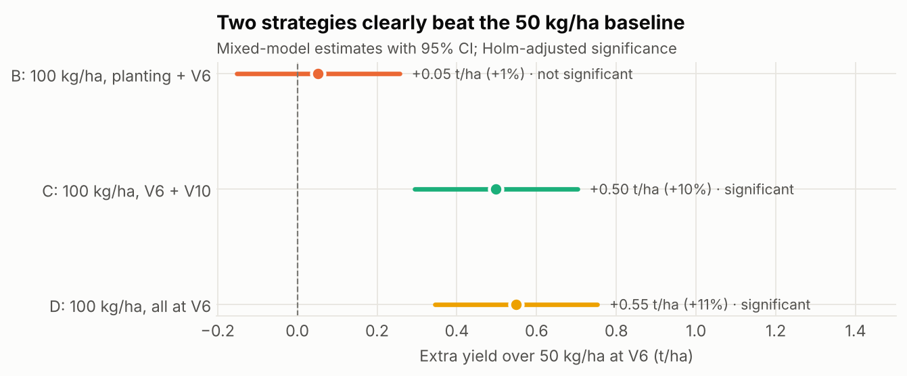

<p align="center">
  
</p>

<h1 align="center">Which fertilizer strategy actually raises maize yield?</h1>

<p align="center">
  <b>Field-trial analysis and decision support for Evergreen, an agricultural NGO in Rwanda</b><br>
  Python · Mixed-effects models · Random Forest · Grouped cross-validation · Partial-budget economics
</p>

<p align="center">
  
  
  
  
  
</p>

> **About the data.** The original trial data is confidential, so this repository runs on a **synthetic dataset** with the same structure, variables and data-quality problems (`01_Data/sample/`). Every number and chart below comes from running the notebooks on that synthetic data. The results show the method and the deliverables; they are not Evergreen's actual findings.

---

## At a glance

| | |
|---|---|
| **Client question** | Which of four Urea rate-and-timing strategies should Evergreen's extension officers recommend? |
| **Data** | 1,590 trial plots · 397 field-seasons · 3 seasons (21A, 22A, 22B) · 4 mega-environments *(synthetic)* |
| **Answer** | Apply **100 kg/ha of Urea, all at the V6 stage**: **+0.55 t/ha (≈ +11%)** over the current 50 kg/ha, statistically significant, best in **all four** mega-environments |
| **Does it pay?** | Yes. Every franc spent on the extra Urea returns **3.4 francs** of maize at trial-period prices (**4.0** at 2026 prices) |
| **Also good** | Splitting 100 kg/ha between V6 and V10 is statistically equivalent overall (p = 1.00) |
| **Drop** | Splitting between planting and V6: almost no gain (+0.05 t/ha) and it doesn't cover its cost |
| **Deliverables** | [Decision-support tool](03_Report/decision_tool/index.html) · [Field map](03_Report/maps/trial_fields_map.html) · [Project charter](00_Project_Management/project_charter.md) · [Data audit log](01_Data/audit/data_audit_log.md) · [Analysis report](03_Report/analysis_report.md) · [Client deck](03_Report/reports/Maize_Yield_Client_Deck.pptx) |

---

## The key result

<p align="center">
  
</p>

| Treatment | Adjusted mean yield | Gain vs. 50 kg/ha (95% CI) | Significant? (Holm) | Value-cost ratio* |
|---|---:|---:|:---:|---:|
| A · 50 kg/ha, all at V6 (current) | 4.94 t/ha | – | – | – |
| B · 100 kg/ha, planting + V6 | 4.99 t/ha | +0.05 (−0.15 to 0.26) | No | 0.3 |
| C · 100 kg/ha, V6 + V10 | 5.44 t/ha | +0.50 (0.29 to 0.70) | Yes | 3.1 |
| **D · 100 kg/ha, all at V6** | **5.49 t/ha** | **+0.55 (0.34 to 0.75)** | **Yes** | **3.4** |

<sub>*Value of extra maize ÷ cost of extra Urea at 2022 prices (Urea RWF 754/kg subsidised, maize RWF 237/kg). ≥ 2 is a common adoption threshold. Model: 1,582 plots in 397 field-seasons.</sub>

**One recommendation works everywhere.** Treatment D ranked first in every mega-environment, and treatment effects did not differ significantly by environment (p = 0.08) or season (p = 0.10). Within the Highlands and Low-Mid-Dry zones, D also edged out the V6 + V10 split (p ≈ 0.05); elsewhere the two were tied.

<p align="center">
  
</p>

---

## Decision-support tool

[`03_Report/decision_tool/index.html`](03_Report/decision_tool/index.html) is a single offline page for extension teams. Choose a mega-environment, enter today's Urea and maize prices, and it returns:

* the recommended strategy,
* the expected gain with its confidence interval,
* the value-cost ratio and net benefit per hectare, and
* pooled vs. local estimates side by side.

Download the file and open it in any browser, or enable GitHub Pages to share a link.

---

## What I did

1. **Scoped the work** in a [project charter](00_Project_Management/project_charter.md): objectives, deliverables, assumptions, risks and stakeholders.
2. **Audited the data.** 22 automated checks are logged in a [data audit log](01_Data/audit/data_audit_log.md) that is regenerated from the data on every run. Findings include orphan plots, incomplete units, season-specific missingness, a 55 t/ha entry error and GPS altitudes of 0 m.
3. **Cleaned without losing information.** Source data is untouched, problems are flagged rather than deleted, and every join is validated. Output: one combined dataset, one row per plot.
4. **Estimated treatment effects properly.** A linear mixed-effects model with field as a random effect, Holm-corrected pairwise tests, likelihood-ratio interaction tests, per-environment models and an outlier sensitivity check.
5. **Ranked the yield drivers and built a prediction model.** Random Forest vs. Ridge vs. baseline with **grouped cross-validation** (whole fields held out), plus permutation importance on unseen fields.
6. **Tested profitability** with a value-cost ratio under three published price scenarios.
7. **Turned it into advice:** a decision rule, an interactive tool, a [written report](03_Report/analysis_report.md) and a client deck.
8. **Made it reproducible.** The notebooks and one pipeline command rebuild every table and figure, tests run on the synthetic data, and enrichment scripts handle CHIRPS rainfall and SoilGrids soil data.

## What drives yield?

<p align="center">
  
</p>

**Mega-environment dominates**: Low-Mid-Dry fields yield about 1.2–1.4 t/ha more than the rest. Seed rate, soil colour, slope and season follow far behind, and the Urea treatment ranks 7th of 18. In this synthetic data, yields were simulated from mega-environment, season, treatment and field effects, so the ranking mostly reflects how the data was built. With real trial data, this same analysis is what reveals which site and management factors matter.

## About the limits

- **Prediction is weak on this data.** Ridge regression and the Random Forest only just beat predicting the average (MAE 1.25 and 1.27 vs 1.29 t/ha on unseen fields; R² ≈ 0.03, or 0.09 without the entry-error plot). The synthetic fields carry little predictive information beyond environment and treatment, so the honest conclusion is: useful for setting expectations, not for forecasting a single farm.
- **Weather and soil enrichment run locally.** The CHIRPS and SoilGrids scripts are cached, rate-limited and resumable, and the pipeline picks up their output automatically. They are switched off for the synthetic sample, whose coordinates are made up.
- **The economics is a partial budget.** Labour and transport costs are not included.

<details>
<summary><b>Model comparison and diagnostics</b></summary>

| Model (grouped 5-fold CV) | MAE (t/ha) | RMSE (t/ha) | R² |
|---|---:|---:|---:|
| Ridge Regression | 1.252 | 1.994 | 0.032 |
| Random Forest | 1.269 | 2.015 | 0.011 |
| Mean baseline | 1.286 | 2.032 | −0.005 |
| *Random Forest, without the 55 t/ha entry error* | *1.201* | *1.520* | *0.094* |

<table>
  <tr>
    <td width="50%"><br><sub>Yield distribution by treatment</sub></td>
    <td width="50%"><br><sub>Value-cost ratio by price scenario</sub></td>
  </tr>
  <tr>
    <td width="50%"><br><sub>Observed vs. predicted yield (unseen fields)</sub></td>
    <td width="50%"><br><sub>Trial fields by season (synthetic locations)</sub></td>
  </tr>
</table>
</details>

---

## Explore the work

| Notebook | What's inside |
|---|---|
| [01 Data audit](02_Notebooks/01_data_audit.ipynb) | Structure, keys, experimental design, missingness, the audit log |
| [02 Cleaning & integration](02_Notebooks/02_data_cleaning_and_integration.ipynb) | Flags instead of deletions, validated joins, combined dataset |
| [03 EDA & field map](02_Notebooks/03_exploratory_data_analysis.ipynb) | Yield by treatment, season and environment; trial map |
| [04 Treatment effects](02_Notebooks/04_treatment_effect_analysis.ipynb) | **Mixed-effects model, pairwise tests, per-environment results, sensitivity** |
| [05 Data enrichment](02_Notebooks/05_data_enrichment.ipynb) | CHIRPS rainfall and SoilGrids soil data |
| [06 Yield prediction & drivers](02_Notebooks/06_yield_prediction.ipynb) | Grouped CV, error analysis, permutation importance |
| [07 Fertilizer advisory](02_Notebooks/07_fertilizer_advisory.ipynb) | **Economics, decision rule and decision tool** |

<details>
<summary><b>Run it yourself</b></summary>

```bash
git clone https://github.com/Vin-Okumu/maize-yield-optimization.git
cd maize-yield-optimization
conda env create -f environment.yml
conda activate maize-yield

python run_pipeline.py      # rebuilds tables, figures, maps and the decision tool
pytest -q                   # runs the tests
jupyter lab                 # notebooks 01 → 07
```

Everything runs on the **synthetic sample** in `01_Data/sample/` and reproduces the numbers above. Anyone with access to the confidential trial files can put them in `01_Data/raw/`, and they are picked up automatically. See [`01_Data/README.md`](01_Data/README.md).

**Optional enrichment** (needs internet):
```bash
python scripts/fetch_chirps_rainfall.py   # rain_plant_silking from CHIRPS
python scripts/fetch_soilgrids.py         # fills tot_N, org_C, sand from SoilGrids
python run_pipeline.py                    # re-run to include them
```
</details>

<details>
<summary><b>Repository structure</b></summary>

```
maize-yield-optimization/
├── 00_Project_Management/   project charter
├── 01_Data/
│   ├── raw/                 confidential source files (git-ignored)
│   ├── sample/              synthetic data used for all published results
│   ├── processed/           cleaned + combined dataset (generated, git-ignored)
│   ├── external/            CHIRPS / SoilGrids extracts (generated, git-ignored)
│   ├── audit/               data audit log (.md + .csv)
│   └── data_dictionary.md
├── 02_Notebooks/            01–07 analysis walkthrough
├── 03_Report/
│   ├── analysis_report.md
│   ├── figures/  tables/  maps/   (from the synthetic sample)
│   ├── decision_tool/       offline HTML advisory tool
│   └── reports/             client deck
├── 04_Images/               banners
├── scripts/                 synthetic data + enrichment downloads
├── src/maize/               analysis package used by the pipeline and notebooks
├── tests/
├── run_pipeline.py
├── environment.yml · requirements.txt
└── CHANGELOG.md · LICENSE
```
</details>

---

## Need something similar?

I help organizations, NGOs and researchers turn messy field-trial and survey data into clear, defensible decisions: experimental analysis, mixed models, predictive modelling, and reports and tools that non-technical teams can act on.

Have a similar project? Invite me on [Upwork](https://www.upwork.com/freelancers/uv23o9) · Connect on [LinkedIn](https://www.linkedin.com/in/vince-okumu23/) · Email vinny.otieno23@gmail.com

**Vincent Okumu**
