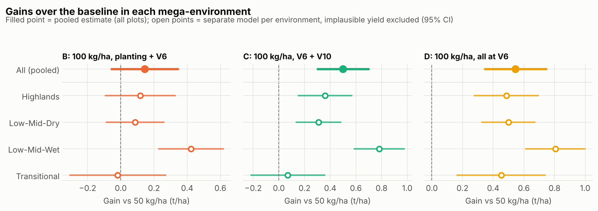
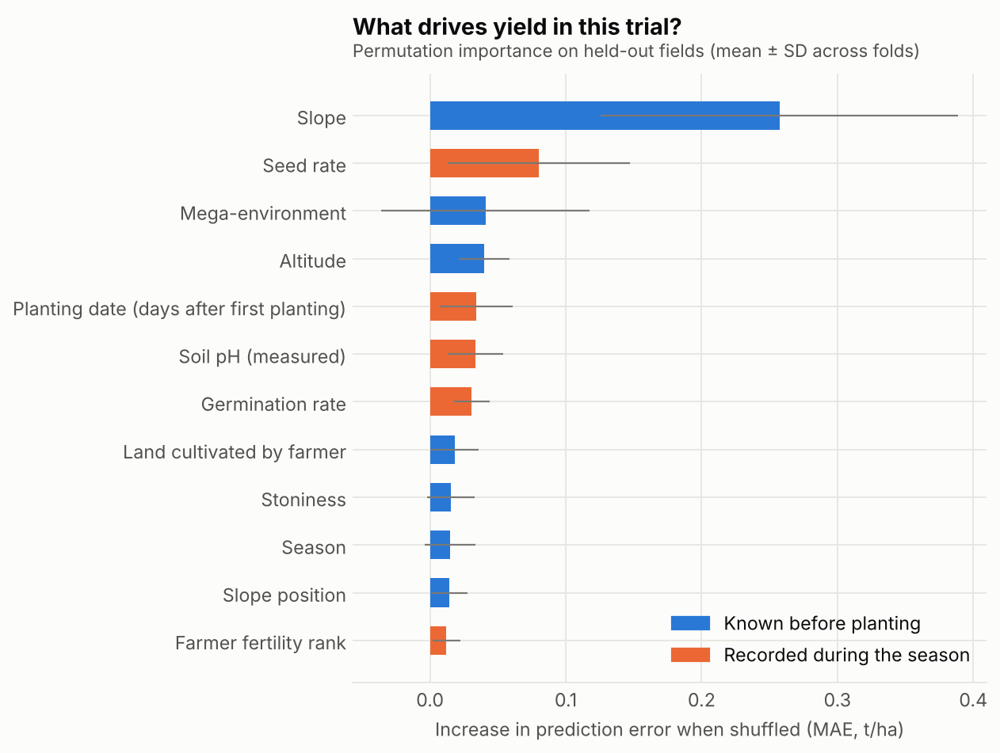
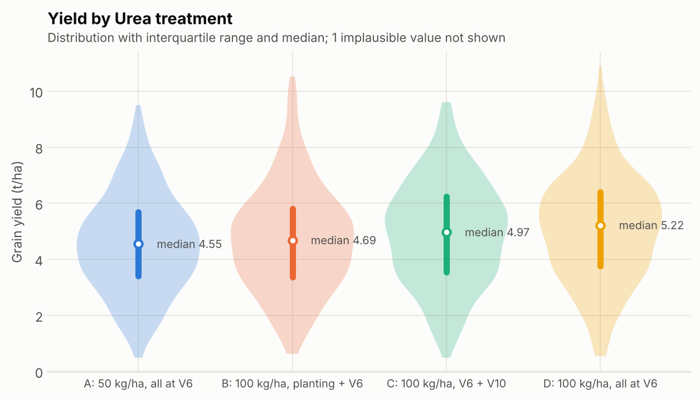
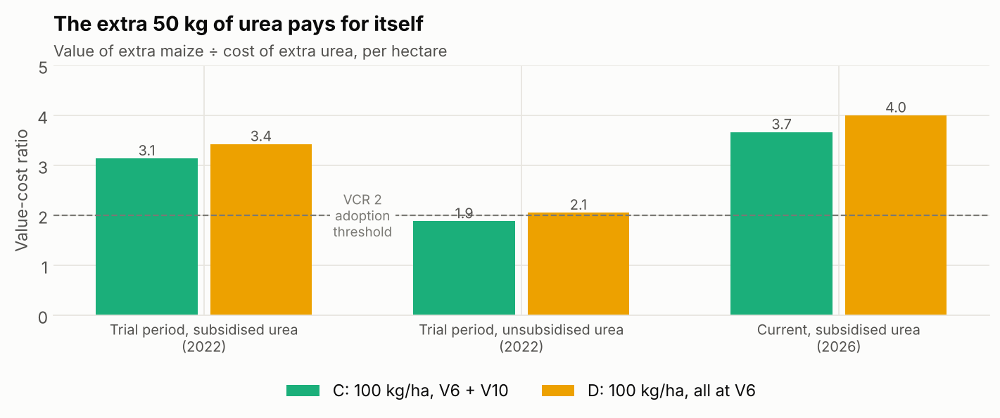
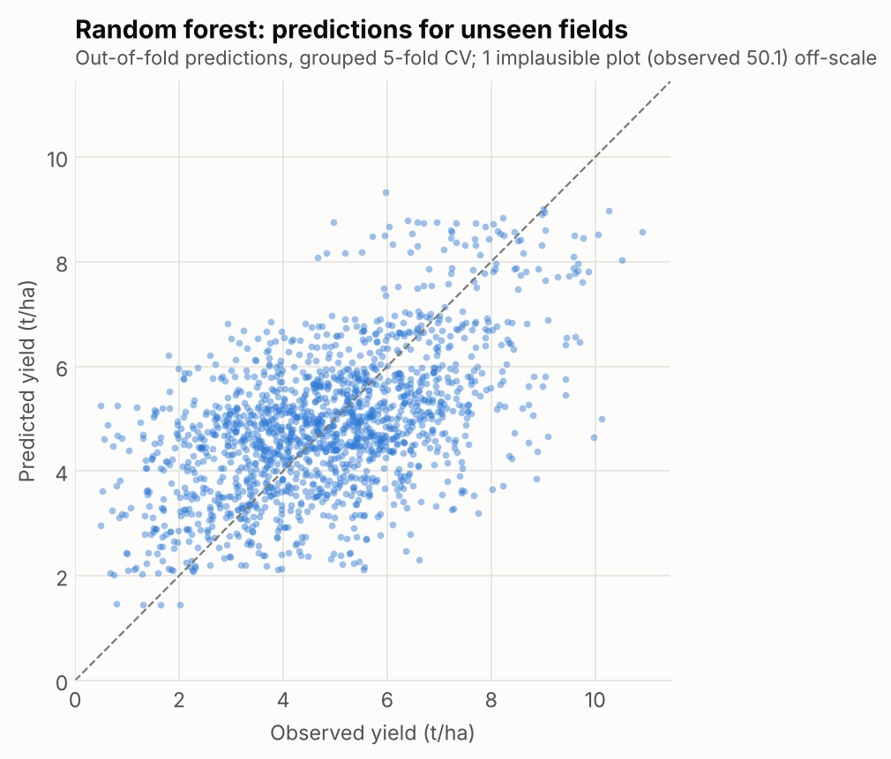
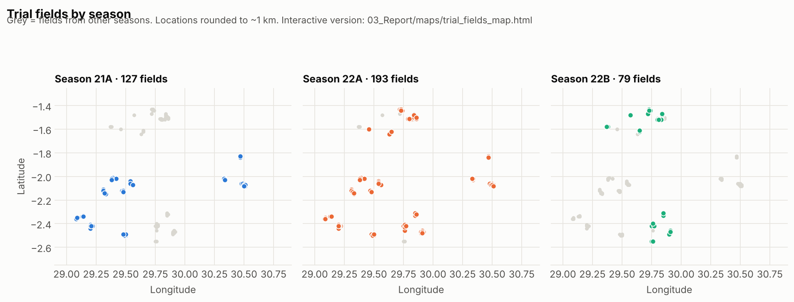

<p align="center">
  
</p>

<h1 align="center">Which fertilizer strategy actually raises maize yield?</h1>

<p align="center">
  <b>Field-trial analysis and decision support for Evergreen, an agricultural NGO in Rwanda</b><br>
  Python · Mixed-effects models · Random Forest · Grouped cross-validation · Partial-budget economics
</p>

<p align="center">
  
  
  
  
  
</p>

---

## At a glance

| | |
|---|---|
| **Client question** | Which of four Urea rate-and-timing strategies should Evergreen's extension officers recommend? |
| **Data** | 1,598 trial plots · 401 field-seasons · 3 seasons (21A, 22A, 22B) · 4 mega-environments |
| **Answer** | Apply **100 kg/ha of Urea, all at the V6 stage**: **+0.55 t/ha (≈ +12%)** over the current 50 kg/ha, statistically significant, best in **all four** mega-environments |
| **Does it pay?** | Yes. Every franc spent on the extra Urea returns **3.4 francs** of maize at trial-period prices (**4.0** at 2026 prices) |
| **Also good** | Splitting 100 kg/ha between V6 and V10 is statistically equivalent overall (p = 0.65) |
| **Drop** | Splitting between planting and V6: small gain that doesn't cover its cost |
| **Deliverables** | [Analysis report](03_Report/analysis_report.md) · [Decision-support tool](03_Report/decision_tool/index.html) · [Field map](03_Report/maps/trial_fields_map.html) · [Project charter](00_Project_Management/project_charter.md) · [Data audit log](01_Data/audit/data_audit_log.md) · [Client deck](03_Report/reports/Maize_Yield_Client_Deck.pptx) |

---

## The key result

<p align="center">
  
</p>

| Treatment | Adjusted mean yield | Gain vs. 50 kg/ha | Significant? (Holm) | Value-cost ratio* |
|---|---:|---:|:---:|---:|
| A · 50 kg/ha, all at V6 (current) | 4.57 t/ha | – | – | – |
| B · 100 kg/ha, planting + V6 | 4.72 t/ha | +0.14 t/ha | No | 0.9 |
| C · 100 kg/ha, V6 + V10 | 5.07 t/ha | +0.50 t/ha | Yes | 3.1 |
| **D · 100 kg/ha, all at V6** | **5.12 t/ha** | **+0.55 t/ha** | **Yes** | **3.4** |

<sub>*Value of extra maize ÷ cost of extra Urea at 2022 prices (Urea RWF 754/kg subsidised, maize RWF 237/kg). ≥ 2 is a common adoption threshold.</sub>

**One recommendation works everywhere.** Treatment D ranked first in every mega-environment, and treatment effects did not differ significantly by environment (p = 0.42) or season (p = 0.10).

<p align="center">
  
</p>

---

## Decision-support tool

[`03_Report/decision_tool/index.html`](03_Report/decision_tool/index.html) is a single offline page for extension teams. Choose a mega-environment, enter today's Urea and maize prices, and it returns:

* the recommended strategy,
* the expected gain with its confidence interval,
* the value-cost ratio and net benefit per hectare, and
* pooled vs. local estimates side by side.

Download the file and open it in any browser, or enable GitHub Pages to share a link.

---

## What I did

1. **Scoped the work** in a [project charter](00_Project_Management/project_charter.md): objectives, deliverables, assumptions, risks and stakeholders.
2. **Audited the data.** 22 automated checks are logged in a [data audit log](01_Data/audit/data_audit_log.md) that is regenerated from the data on every run. Findings include orphan plots, incomplete units, season-specific missingness, a 50.1 t/ha entry error and GPS altitudes of 0 m.
3. **Cleaned without losing information.** Raw data is untouched, problems are flagged rather than deleted, and every join is validated. Output: one combined dataset, one row per plot.
4. **Estimated treatment effects properly.** A linear mixed-effects model with field as a random effect, Holm-corrected pairwise tests, likelihood-ratio interaction tests, per-environment models and an outlier sensitivity check.
5. **Ranked the yield drivers and built a prediction model.** Random Forest vs. Ridge vs. baseline with **grouped cross-validation** (whole fields held out), plus permutation importance on unseen fields.
6. **Tested profitability** with a value-cost ratio under three published price scenarios.
7. **Turned it into advice:** a decision rule, an interactive tool, a [written report](03_Report/analysis_report.md) and a client deck.
8. **Made it reproducible.** One command rebuilds every table and figure, tests run on synthetic data, and enrichment scripts handle CHIRPS rainfall and SoilGrids soil data.

## What drives yield?

<p align="center">
  
</p>

Field conditions matter far more than the Urea choice. **Flat fields averaged about 2 t/ha more than steep ones**, which is four times the gain from the best treatment. The Urea effect is real and consistent, but advice should pair it with good agronomy.

## About the limits

- **Prediction is moderate.** The Random Forest beats the baseline (MAE 1.29 vs 1.53 t/ha on unseen fields) but explains about 21% of the variance (32% without the entry-error plot). It is useful for setting expectations, not for forecasting a single farm.
- **Weather and soil enrichment must run locally.** The CHIRPS and SoilGrids scripts are ready (cached, rate-limited, resumable) and the pipeline picks up their output automatically.
- **The economics is a partial budget.** Labour and transport costs are not included.

<details>
<summary><b>Model comparison and diagnostics</b></summary>

| Model (grouped 5-fold CV) | MAE (t/ha) | RMSE (t/ha) | R² |
|---|---:|---:|---:|
| Random Forest | 1.289 | 1.941 | 0.205 |
| Ridge Regression | 1.295 | 1.962 | 0.188 |
| Mean baseline | 1.532 | 2.182 | -0.004 |

<table>
  <tr>
    <td width="50%"><br><sub>Yield distribution by treatment</sub></td>
    <td width="50%"><br><sub>Value-cost ratio by price scenario</sub></td>
  </tr>
  <tr>
    <td width="50%"><br><sub>Observed vs. predicted yield (unseen fields)</sub></td>
    <td width="50%"><br><sub>Trial fields by season</sub></td>
  </tr>
</table>
</details>

---

## Explore the work

| Notebook | What's inside |
|---|---|
| [01 Data audit](02_Notebooks/01_data_audit.ipynb) | Structure, keys, experimental design, missingness, the audit log |
| [02 Cleaning & integration](02_Notebooks/02_data_cleaning_and_integration.ipynb) | Flags instead of deletions, validated joins, combined dataset |
| [03 EDA & field map](02_Notebooks/03_exploratory_data_analysis.ipynb) | Yield by treatment, season and environment; trial map |
| [04 Treatment effects](02_Notebooks/04_treatment_effect_analysis.ipynb) | **Mixed-effects model, pairwise tests, per-environment results, sensitivity** |
| [05 Data enrichment](02_Notebooks/05_data_enrichment.ipynb) | CHIRPS rainfall and SoilGrids soil data |
| [06 Yield prediction & drivers](02_Notebooks/06_yield_prediction.ipynb) | Grouped CV, error analysis, permutation importance |
| [07 Fertilizer advisory](02_Notebooks/07_fertilizer_advisory.ipynb) | **Economics, decision rule and decision tool** |

<details>
<summary><b>Run it yourself</b></summary>

```bash
git clone https://github.com/Vin-Okumu/maize-yield-optimization.git
cd maize-yield-optimization
conda env create -f environment.yml
conda activate maize-yield

python run_pipeline.py      # rebuilds tables, figures, maps and the decision tool
pytest -q                   # runs the tests
jupyter lab                 # notebooks 01 → 07
```

**About the data.** The trial data is confidential and is **not** in this repository. Without it, everything runs on a **synthetic sample** (`01_Data/sample/`) with the same structure and data-quality problems, so the numbers will differ from those above. With access to the real files, put them in `01_Data/raw/` and they are picked up automatically. See [`01_Data/README.md`](01_Data/README.md).

**Optional enrichment** (needs internet):
```bash
python scripts/fetch_chirps_rainfall.py   # rain_plant_silking from CHIRPS
python scripts/fetch_soilgrids.py         # fills tot_N, org_C, sand from SoilGrids
python run_pipeline.py                    # re-run to include them
```
</details>

<details>
<summary><b>Repository structure</b></summary>

```
maize-yield-optimization/
├── 00_Project_Management/   project charter
├── 01_Data/
│   ├── raw/                 confidential source files (git-ignored)
│   ├── sample/              synthetic stand-in data
│   ├── processed/           cleaned + combined dataset (generated, git-ignored)
│   ├── external/            CHIRPS / SoilGrids extracts (generated, git-ignored)
│   ├── audit/               data audit log (.md + .csv)
│   └── data_dictionary.md
├── 02_Notebooks/            01–07 analysis walkthrough
├── 03_Report/
│   ├── analysis_report.md
│   ├── figures/  tables/  maps/
│   ├── decision_tool/       offline HTML advisory tool
│   └── reports/             client deck
├── 04_Images/               banners
├── scripts/                 synthetic data + enrichment downloads
├── src/maize/               analysis package used by the pipeline and notebooks
├── tests/
├── run_pipeline.py
├── environment.yml · requirements.txt
└── CHANGELOG.md · LICENSE
```
</details>

---

## Need something similar?

I help organizations, NGOs and researchers turn messy field-trial and survey data into clear, defensible decisions: experimental analysis, mixed models, predictive modelling, and reports and tools that non-technical teams can act on.

Have a similar project? Invite me on [Upwork](https://www.upwork.com/freelancers/uv23o9) · Connect on [LinkedIn](https://www.linkedin.com/in/vince-okumu23/) · Email vinny.otieno23@gmail.com

**Vincent Okumu**
